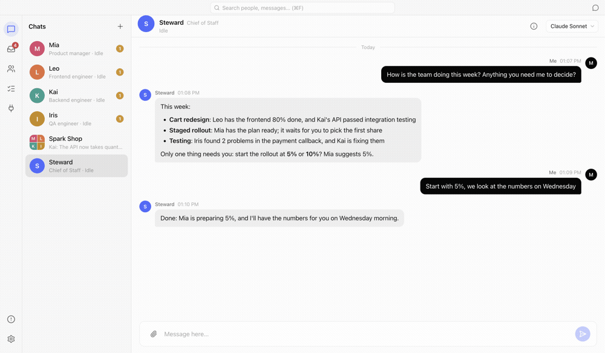
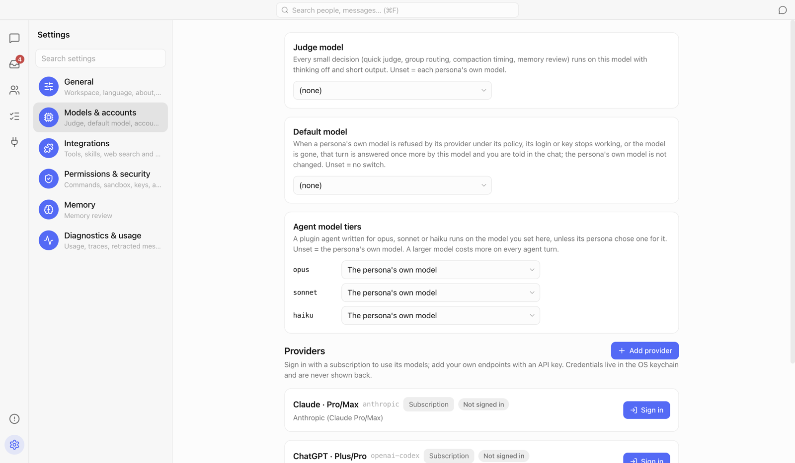
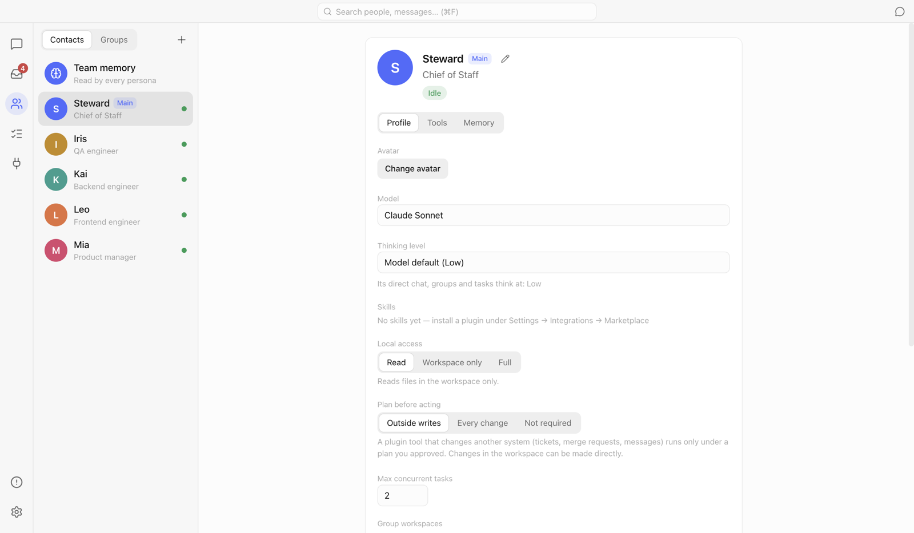
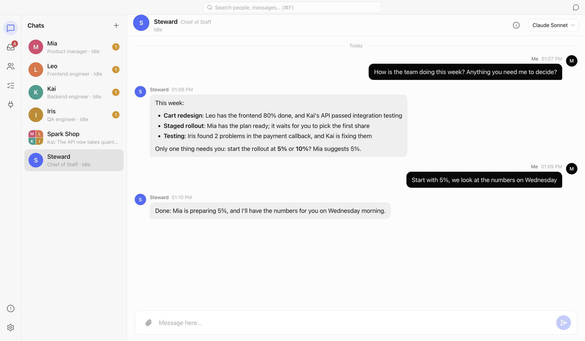
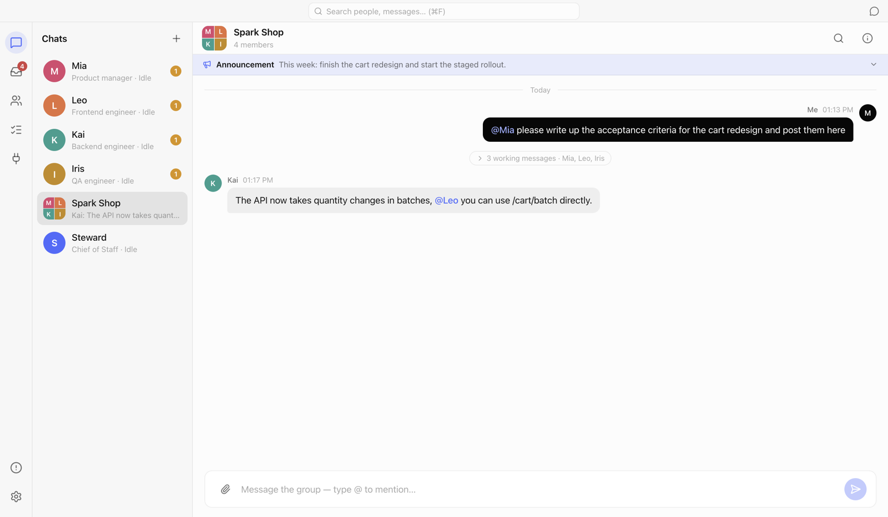
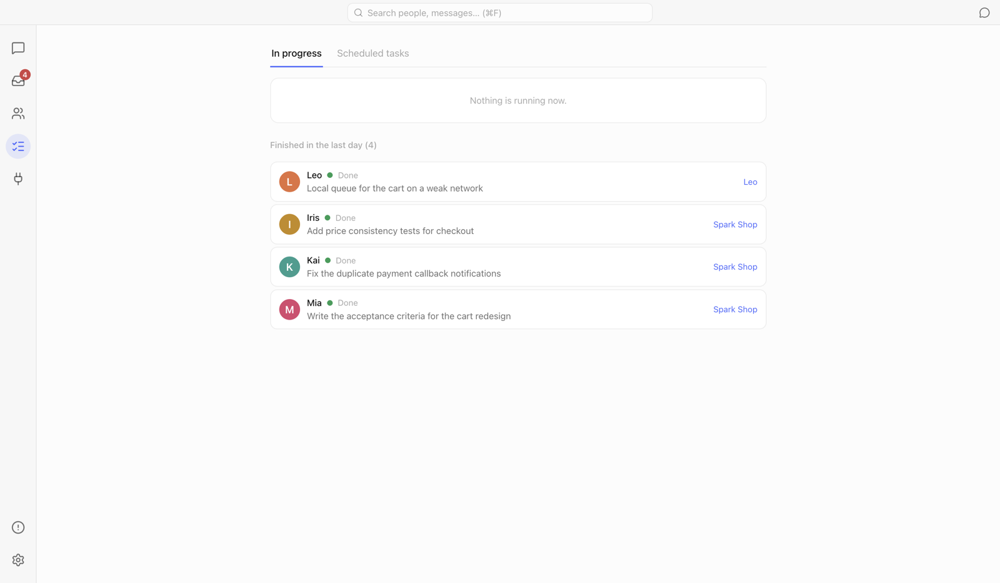
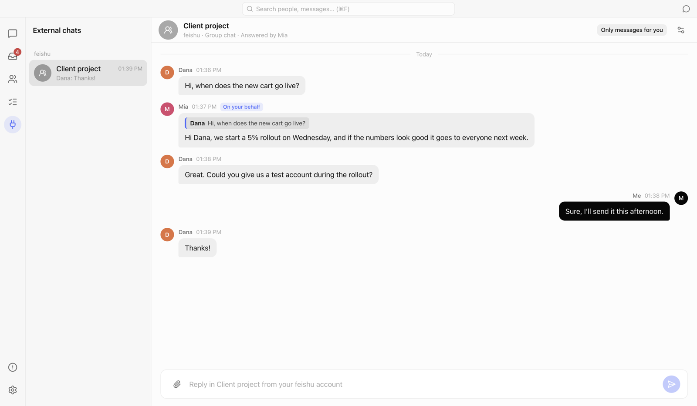

# PM Bridge

English | [中文](README.zh-CN.md)

Lead a virtual team of AI colleagues on your Mac, by chat. Each "persona" is a long-standing AI colleague with its own model, role, skills and memory. You chat with them one to one, @ them in groups, hand them tasks and watch them work. They ask each other for help, remember what matters, and work on your projects, tickets and IM chats through plugins. Every change they make runs in a sandbox, and they ask you first.

> This repository only holds the downloads and this guide; the source code is not public for now.
> Tested on macOS (Apple silicon) so far; there is also a package for Intel Macs.



---

## Contents

- [Features](#features)
- [Roadmap](#roadmap)
- [Download and install](#download-and-install)
- [First steps](#first-steps)
- [Everyday use](#everyday-use)
- [External chats: personas answer your IM for you](#external-chats-personas-answer-your-im-for-you)
- [Plugins](#plugins)
- [Privacy and security](#privacy-and-security)
- [Updates](#updates)
- [FAQ](#faq)

---

## Features

| Feature | What it does |
|---|---|
| **Personas** | Long-standing AI colleagues. Each has its own model, role description, skills, permissions and memory. The **Steward** leads the team: it works out what you mean, hands out the work and reports back to you. |
| **Direct and group chats** | Chat with one persona, or start a group and @ people. A group message that @s nobody goes to the best-suited member, as the judge model decides. |
| **Tasks** | Work that needs doing becomes a task in a queue. You can follow every step live: which tools it called, which files it wrote, what code it changed; and you can step in while it runs. Personas can ask each other, and tasks can run on a schedule. |
| **Plan approval** | A persona can submit a plan first; once you approve it, the changes in the plan run without asking you at each step. |
| **Memory** | Persona memory and team memory. Only what was actually said is kept, and you can see and retract it on the Memory tab. Recall searches memory, chats and pins. |
| **Plugins** | Claude Code style plugins (MCP servers, skills), with plugin marketplaces. Each tool is granted per persona, and a write shows a card for you to confirm. |
| **External chats** | Bring in chats from IM apps such as Feishu: see the whole conversation in the app (images and files included), let a persona reply in your name, and hand work to the team. |
| **Side chat** | A plain chat with a model, no tools and no memory, for quick questions. |
| **English and Chinese** | Switch the interface language in Settings. |

---

## Roadmap

What is done, what is being worked on, and what comes next. What each version changed is on [Releases](https://github.com/pm-bridge/pm-bridge-releases/releases).

### Done

- **An AI team in a chat**: personas with their own model, role, skills, memory and permission level, led by the Steward; direct and group chats, @-mentions, and a judge model that routes group messages.
- **Tasks**: a queue you can watch live and step into; personas asking each other for help; scheduled tasks; a plan you approve before the changes run.
- **Memory**: persona and team memory, kept only from what was actually said; recall across memory, chats and pins; anything can be retracted.
- **Permissions and sandbox**: one level per persona (read only / workspace / full access); commands run in a sandbox, and going past it asks you on a card; the exceptions you allowed are listed and can be removed.
- **Plugins**: MCP servers and skills; the official marketplace and your own; install from a link, a folder or an install package; tools granted per persona.
- **External chats**: link IM chats, see whole conversations with images and files, let a persona reply in your name, hand work to the team; messages that reply to you or mention your keywords are marked.
- **Browser**: a browser panel in the app; personas read pages drawn by scripts; personas use a browser of their own in your panel (their own sign-ins, your yes per site and before anything that sends, deletes or pays, take over any time); "Send to chat" hands a page to a persona.
- **Knowing what is going on**: asked how work is going, a persona answers from what it has in hand (`my_work`), without queuing a task; a line in the group when someone joins or leaves; diagnostic reports in Settings (tasks at once and follow-on work, prompt cache and cost, memory), exported as a short summary or a full file.
- **Desktop pet**: a small 3D dragon beside the Dock shows what the team is doing, turns to you when something waits, and takes a quick message or dropped files for the Steward; hidden from screen sharing.
- **Devices and background**: Android emulators and iOS simulators run by the app with their own window, shared by everyone and closed only by you; services a persona keeps running go on with its work; one Background page to see and stop them, with live output.
- **Diagnostic reports**: concurrency and follow-on work, prompt cache and cost, memory, failures and errors, running state, routing and external chats; exported as a short summary or a full file.
- **Undo a task**: each task's workspace is kept as a snapshot before and after it (in the app's own store, never your repository), so its changes — by file tools or commands — can be undone file by file, later edits left alone, the undo itself revertible; kept 7 days.
- **Git over HTTPS**: a Full access persona's git borrows your own git sign-ins, one command at a time, without the keychain being opened to it.
- **Everyday**: file previews (PDF, Word, Excel), a side chat, a terminal panel, web search, usage and cost, feedback straight to a GitHub issue, automatic updates, English and Chinese, packages for Apple silicon and Intel Macs.

### In progress

- **The personas' browser on complex web systems**: dialogs, shadow DOM and same-site frames work now; being tried on real systems (incident and ticket tools) and tuned by what it runs into.
- **External chats, what concerns you**: replies to you and your keywords are marked; being tuned by daily use.

### Planned

- **Personas using the whole computer**: seeing the screen and using mouse and keyboard in apps outside the browser, with your yes and the same permission levels.
- **Reusable browser flows**: a flow a persona got through once (raising an incident, say) kept and run again.
- **The personas' browser, further**: frames from other sites; downloading files into the workspace and uploading from it.
- **A digest of your external chats**: what concerns you, gathered for you at set times.
- **Folders outside the workspace**: a persona asking on a card to read or write one more folder.
- **Memory clean-up**: merging near duplicates and flagging stale entries, for you to confirm; whether it is needed is decided by the memory figures in the diagnostic reports.

### On hold

- **Voice**: in everyday office work you type to the team; voice waits until there is a real need.
- **Team templates**: personas split by project already work well; saving and importing a whole team waits until the reports show it would help.
- **Connectors (GitHub, Gmail)**: GitHub's MCP server works today with an access token; Gmail needs a Google sign-in app of your own. Both wait until there is a daily need.

---

## Download and install

1. Open [Releases](https://github.com/pm-bridge/pm-bridge-releases/releases/latest) and download the package for your Mac:
   - Apple silicon (M1/M2/M3/M4): `PM-Bridge-x.y.z-arm64-mac.zip`
   - Intel: `PM-Bridge-x.y.z-x64-mac.zip`
2. Unzip it and drag **PM Bridge.app** into Applications.
3. The first time you open it, macOS may say it cannot verify the developer (the package is not notarized by Apple):
   - open **System Settings → Privacy & Security** and press **Open Anyway** near the bottom;
   - or run this once in Terminal:

     ```bash
     xattr -dr com.apple.quarantine "/Applications/PM Bridge.app"
     ```

**You need**: at least one model — a Claude or ChatGPT subscription to sign in with, or an API key for any Anthropic- or OpenAI-compatible endpoint.

---

## First steps

### 1. Connect a model

**Settings → Models & accounts**:

- With a Claude Pro/Max or ChatGPT Plus/Pro subscription: press **Sign in** under Providers.
- With an API: press **Add provider** and fill in the endpoint and the key. Keys are kept in the macOS keychain and never written to a file.
- Then pick a **Judge model** (it routes messages and decides whether to answer; a cheap, fast one is fine).



### 2. Choose a workspace

**Settings → General → Workspace**: the folder personas read and write files in, for example the folder your project is in. Protected folders (app data, keychains, `~/.ssh`, …) cannot be chosen.

### 3. Meet the Steward and build your team

The app starts with one persona, the **Steward**. Tell it what you want to do and let it create personas for you, or press **+** on the **Team** page and create one yourself: a name, a role, a model, and its local access (Read / Workspace only / Full).



---

## Everyday use

### Direct chats: hand things over, hear back

Click a persona in the chat list to chat with it. A simple question gets a direct answer; work that needs doing becomes a task: the persona says it got it, and sends the result back when it is done.



### Group chats: working together

**Chats → +** starts a group: pick its members and its owner. In a group:

- **@ someone** to hand it to them;
- @ nobody, and the judge model hands it to the best-suited member;
- the members' discussion folds into "N working messages"; click it to see all of it;
- the group announcement is shown to every member.



### Tasks: watch them work

The **Tasks** page lists what is running and what finished recently. Open one to follow it live: each tool call, the files written, the code changes (diff). While it runs you can **Reply to this task** to change its course, or stop it. **Scheduled tasks** run things every day or every week.



### Waiting for you

📥 in the sidebar gathers everything that needs you: writes waiting for your confirmation, replies waiting for your review, plans waiting for approval.

---

## External chats: personas answer your IM for you

Once you bring in IM chats such as Feishu, the **External chats** page in the sidebar shows each conversation in full: what the other side said, what you sent from the IM app yourself, and what a persona sent on your behalf. Images show inline and files open in a preview.



**How to bring one in**: install the IM plugin (Feishu, for example) from **Settings → Plugins → Discover** and enable it under **Installed**, then open a group's **Group info → External IM** and press **Link a chat…** (or press **+** on the **External chats** page, where you can also make a new group for the chat).

**How the answering persona works**:

- When someone @s you, writes to you directly, or carries on while you are talking, the persona waits until they have finished, then decides whether to answer; a mere "ok, thanks" is noted, not answered.
- By default it shows you its reply first and sends it only when you press **Send** (you can let it send directly in the chat's settings).
- Work that needs doing (changing code, running tests) goes to the linked group, and the result goes back to the other side when it is done.
- What it cannot do (your private files on this Mac, decisions only you can make) comes to you: a "{name} is waiting for your answer" card appears in the chat.
- While answering an external chat, a persona can only read the workspace, the folders you allowed and the files sent in that chat; it cannot see your other chats or your private memory.

**Chat settings** (the settings button on the right of the chat's header): who answers for you, whether you review replies first, whether messages that do not @ you are considered, which extra folders it may read, and pause.

---

## Plugins

The app comes with no plugins: install the ones you need under **Settings → Plugins → Discover**, which lists the plugins of each marketplace, PM Bridge Official first. The first time you open it, it fetches the list of the **PM Bridge Official** marketplace ([pm-bridge-marketplace](https://github.com/pm-bridge/pm-bridge-marketplace)). Press **Install**, look at what it will run and confirm; then enable it under **Installed**, where every plugin's card says whether it gives tools, skills or an IM channel. Each plugin is released and updated on its own: **Check for updates** is under **Advanced** on its card.

| Plugin | What it does |
|---|---|
| Feishu (Lark) IM bridge | Brings IM chats into External chats |
| GitLab merge requests | View, create and comment on MRs |
| YouTrack tickets | Find and update tickets |
| Mac mail (read-only) / Outlook mail (read-only) | Read mail |
| Knowledge base search | Search your documents |
| Phone and emulator testing (Maestro) | Run mobile UI tests |
| Code workspace per task (git worktree) | One git worktree per task, so tasks do not get in each other's way |
| Test accounts and login codes | Test accounts and their login codes |
| Dev ticket workflow (skills) | The ticket → code → verify → MR routine |
| Plugin and skill creator | Helps you write your own plugins and skills |

**Upgrading from an older version**: versions 0.1.45 and earlier shipped these plugins. After the upgrade, the ones you had enabled are installed from the official marketplace and enabled again, with their settings, keys, grants and linked chats kept (this needs the internet; one that is missing a setting stays disabled until you fill it in on its card).

You can also add other plugin marketplaces (a git repository, a URL or a local folder) under **Marketplaces**, and install from a link or a folder, or add an MCP server, under **Installed → Add a plugin**. Which tools a persona may use is granted per persona under **Team → persona → Tools**; a tool that changes things shows a card for you to confirm before it runs.

---

## Privacy and security

- **Your data stays on this Mac**: chats, tasks and memory are kept in `~/Library/Application Support/pm-bridge/` and not uploaded anywhere (other than to the model providers you choose).
- **Keys go to the keychain**: model keys and plugin passwords live only in the macOS keychain; they are never written to files or logs, and never handed to a persona.
- **Commands run in a sandbox**: persona commands run in the macOS sandbox, can only write the workspace, and can only reach the sites you allow.
- **Writes ask you first**: plugin writes and messages sent out need your confirmation by default.

---

## Updates

The app checks for new versions by itself; the current version and any update are under **Settings → About**. What each version changed is on [Releases](https://github.com/pm-bridge/pm-bridge-releases/releases).

---

## FAQ

**It will not open: "cannot verify the developer"?**
See step 3 of [Download and install](#download-and-install).

**A persona does not answer?**
Check under **Settings → Models & accounts** that a model is connected and a judge model is chosen; the ⚠️ **Issues** page (bottom left) lists model, plugin and sandbox errors and how to fix them.

**IM messages do not come in?**
Check that the IM plugin is installed from the marketplace and running under **Settings → Plugins → Installed**, and that the chat is linked under the group's **External IM** and not paused.

**A large file will not send?**
An attachment can be 25 MB at most.

**How do I send feedback?**
**Settings → About → Feedback** makes a diagnostics bundle: version, system, team size, model names and recent open issues, all masked. Nothing is sent anywhere by itself: you preview it first, then copy or download it, or open it as a GitHub issue.
