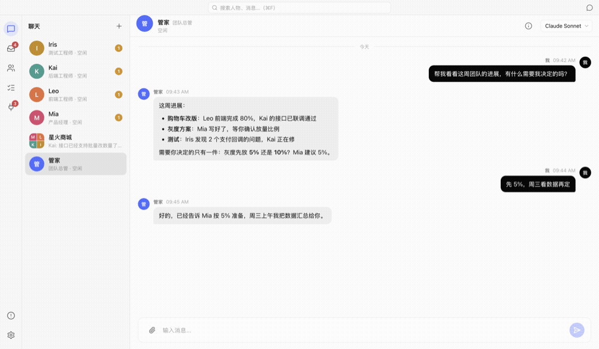
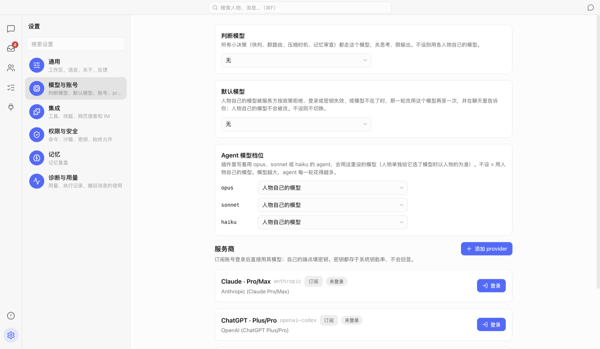
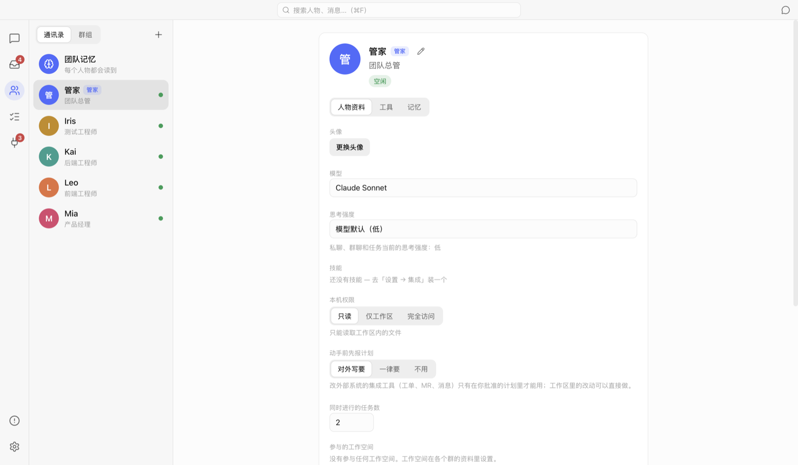
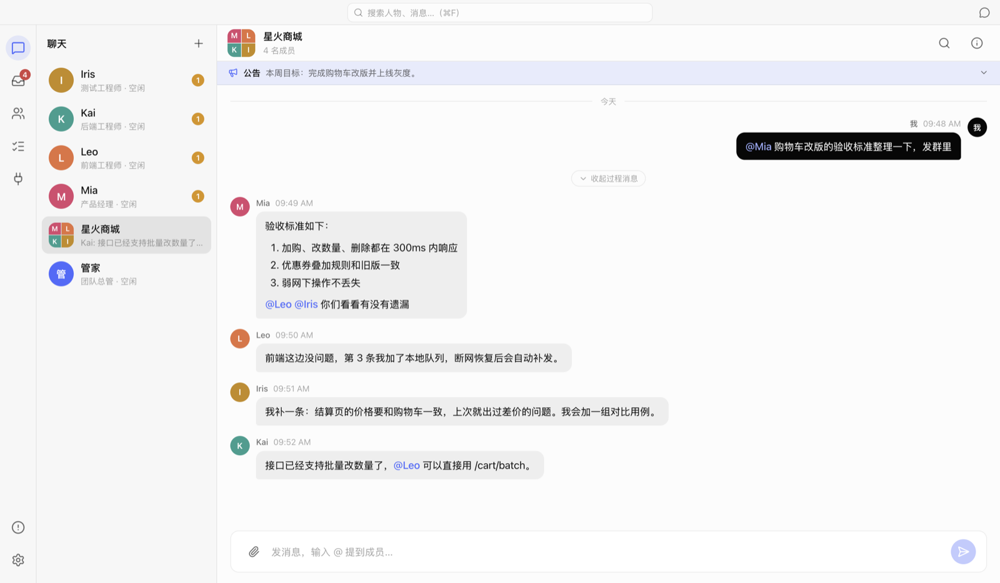
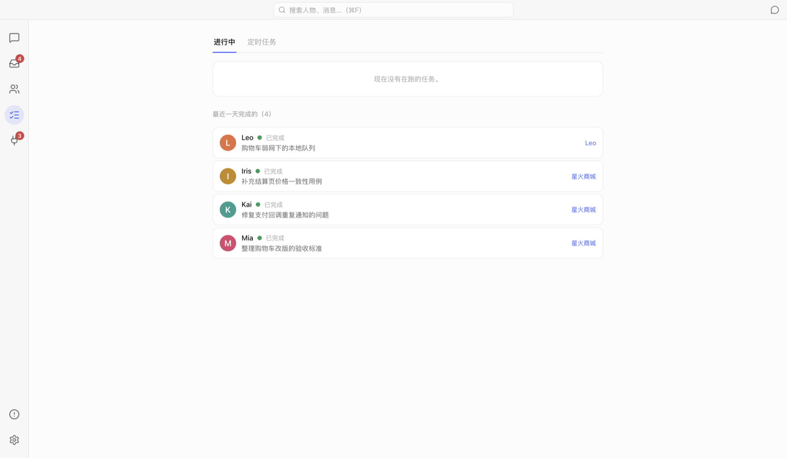
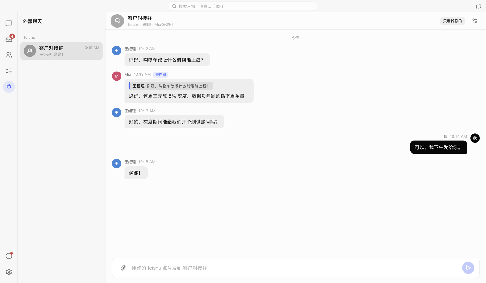

# PM Bridge

[English](README.md) | 中文

在 Mac 上用聊天的方式带一支 AI 虚拟团队：每个“人物”是一个长期在岗的 AI 同事，有自己的模型、职责、技能和记忆。你可以和他们私聊、拉群 @ 人、派任务、看他们实时干活；他们会互相请教、记住重要的事，并通过插件去操作你的项目、工单和 IM —— 所有写操作都在沙箱里，并且先问过你。

> 这个仓库只放安装包和使用说明，源码暂不公开。
> 目前只在 macOS（Apple Silicon）上测试过，Intel Mac 也提供了安装包。



---

## 目录

- [功能一览](#功能一览)
- [下载与安装](#下载与安装)
- [第一次使用](#第一次使用)
- [日常使用流程](#日常使用流程)
- [外部聊天：让人物替你回 IM](#外部聊天让人物替你回-im)
- [插件](#插件)
- [隐私与安全](#隐私与安全)
- [更新](#更新)
- [常见问题](#常见问题)

---

## 功能一览

| 功能 | 说明 |
|---|---|
| **人物** | 长期在岗的 AI 同事。每人有自己的模型、职责说明、技能、权限和记忆；“管家”是团队总管，负责理解你的意思、分派工作、向你汇报。 |
| **私聊与群聊** | 和单个人物私聊，或拉群 @ 人。群里没 @ 人的消息，由判断模型交给最合适的成员。 |
| **任务** | 需要动手的事会变成任务，排队执行，可以实时看每一步、写了哪些文件、改了什么代码；进行中也能插话改方向。人物之间可以互相请教，也支持定时任务。 |
| **计划审批** | 人物可以先提交计划，你批准后，计划里的写操作可以直接执行，不用每一步再确认。 |
| **记忆** | 人物记忆和团队记忆。只记真正说过的原话，可以在记忆页查看、撤回；回忆时能搜记忆、聊天和置顶。 |
| **插件** | 兼容 Claude Code 风格的插件（MCP 服务、技能），支持插件市场；每个工具单独授权，写操作弹卡片等你确认。 |
| **外部聊天** | 把飞书等 IM 的会话接进来：在 App 里看完整的聊天记录（含图片、文件），由接待人物以你的名义回复，需要动手的事交给团队。 |
| **侧边聊天** | 一个不带工具和记忆的纯模型对话，随手问问题用。 |
| **中英文界面** | 设置里切换。 |

---

## 下载与安装

1. 打开 [Releases](https://github.com/pm-bridge/pm-bridge-releases/releases/latest)，按你的 Mac 下载：
   - Apple 芯片（M1/M2/M3/M4）：`PM-Bridge-x.y.z-arm64-mac.zip`
   - Intel 芯片：`PM-Bridge-x.y.z-x64-mac.zip`
2. 解压，把 **PM Bridge.app** 拖进“应用程序”文件夹。
3. 第一次打开时，macOS 可能提示“无法验证开发者”（安装包没有经过 Apple 公证）：
   - 打开 **系统设置 → 隐私与安全性**，在页面下方点 **仍要打开**；
   - 或者在终端执行一次：

     ```bash
     xattr -dr com.apple.quarantine "/Applications/PM Bridge.app"
     ```

**需要准备**：至少一个模型 —— Claude / ChatGPT 订阅账号登录，或者任意 Anthropic / OpenAI 兼容接口的 API 密钥。

---

## 第一次使用

### 1. 接入模型

**设置 → 模型与账号**：

- 有 Claude Pro/Max 或 ChatGPT Plus/Pro 订阅：在“服务商”里点 **登录**。
- 用 API：点 **添加 provider**，填接口地址和密钥。密钥存在 macOS 钥匙串里，不会写进任何文件。
- 再选一个 **判断模型**（用来分派消息、判断要不要回，选便宜快的就行）。



### 2. 选工作区

**设置 → 通用 → 工作区**：人物读写文件的目录，比如你的项目所在的文件夹。应用数据、钥匙串、`~/.ssh` 等受保护的目录不能选。

### 3. 认识管家，组建团队

打开 App 默认有一位 **管家**。你可以直接告诉他你要做什么，让他帮你建人物；也可以在 **团队** 页点 **+** 自己建：起名字、写职责、选模型、设权限（只读 / 仅工作区 / 完全访问）。



---

## 日常使用流程

### 私聊：交代事情、听汇报

在聊天列表里点一个人物就能私聊。简单的问题他直接答；需要动手的会变成任务，先回你一句“收到”，做完再把结果发回来。


### 群聊：多人协作

**聊天 → +** 建群，选成员和群主。在群里：

- **@ 某人** 直接派给他；
- 不 @ 人，判断模型会交给最合适的成员；
- 成员之间的讨论默认折叠成“N 条过程消息”，点开能看完整过程；
- 群公告会给所有成员看到。



### 任务：看他们干活

**任务** 页列出正在做的和最近完成的任务。点进去能看实时进度：每一步调用了什么工具、写了哪些文件、代码改动（diff）。进行中可以 **回复这个任务** 插话改方向，也可以停止。**定时任务** 页可以设置每天、每周自动执行的事。



### 等你处理

左侧栏的 📥 汇总所有需要你的事：待确认的写操作、等你审的回复、计划审批等。

---

## 外部聊天：让人物替你回 IM

把飞书等 IM 的会话接进来后，左侧栏 **外部聊天** 页会显示这些会话的完整记录：对方说的、你在 IM 里自己发的、人物替你发的，都在里面；图片直接显示，文件点开预览。



**怎么接入**：在 **设置 → 插件 → 市场** 里装好 IM 插件（比如飞书），在 **已安装** 里启用；然后打开某个群的 **群资料 → 外部 IM**，点 **接入会话…**（也可以在 **外部聊天** 页点 **+**，还能为这个会话新建一个群）。

**接待人物怎么工作**：

- 有人 @ 你、私聊你、或者在你们正聊着时接着说，接待人物会等对方说完，再判断要不要回；只是“好的谢谢”这类的话，只记下不回。
- 默认先把回复给你看，你点 **发送** 才发出去（可以在会话设置里改成直接发）。
- 需要动手的事（改代码、跑测试）会交给绑定的群去做，做完再把结果告诉对方。
- 它做不了的事（比如你电脑上的私人文件、需要你本人决定的事）会交给你：会话里出现一张“XX 在等你回复”的卡片。
- 替你回外部聊天时，人物只能读工作区、你允许的文件夹和聊天里收发过的文件，看不到你的其他聊天和私人记忆。

**会话设置**（会话头部右侧的设置按钮）：谁替你回、回复要不要先给你看、没 @ 你的消息要不要判断、还能读哪些文件夹、暂停。

---

## 插件

App 本身不带插件，要用哪个就去 **设置 → 插件 → 市场** 里装（把链接或文件夹粘进上面的框，或者在市场卡片上点安装）：第一次打开市场页时，会自动获取 **PM Bridge 官方** 市场（[pm-bridge-marketplace](https://github.com/pm-bridge/pm-bridge-marketplace)）的插件列表。点 **安装**，看过它会运行什么之后确认；装好后在 **已安装** 里启用，每张卡片都写明它提供的是工具、技能还是 IM 通道。每个插件单独发布、单独更新，在插件卡片的“高级”里 **检查更新**。

| 插件 | 用途 |
|---|---|
| 飞书 IM 桥接 | 把 IM 会话接进外部聊天 |
| GitLab 合并请求 | 查看、创建、评论 MR |
| YouTrack 工单 | 查询和更新工单 |
| 本机邮件（只读）/ Outlook 邮件（只读） | 读邮件 |
| 知识库搜索 | 搜你的文档库 |
| 手机与模拟器测试（Maestro） | 跑移动端 UI 测试 |
| 每个任务的独立代码目录 | 每个任务一个 git worktree，互不干扰 |
| 测试账号与登录验证码 | 给测试用的账号和验证码 |
| 开发工单流程（技能） | 工单 → 编码 → 验证 → MR 的标准流程 |
| 插件与技能生成器 | 帮你写自己的插件和技能 |

**从旧版本升级**：0.1.45 及以前的版本自带这些插件。升级后，你原来启用着的插件会自动从官方市场装好并启用，设置、密钥、授权和外部聊天的接入都保留（需要联网；缺设置的会先停用，在卡片上填好再启用）。

也可以添加别的插件市场（git 仓库、网址或本地文件夹）。每个人物用哪些工具在 **团队 → 人物 → 工具** 里单独授权；会改东西的工具，调用前会弹卡片等你确认。

---

## 隐私与安全

- **数据都在本机**：聊天、任务、记忆存在 `~/Library/Application Support/pm-bridge/`，不上传到任何服务器（除了你选的模型服务商本身）。
- **密钥进钥匙串**：模型密钥、插件密码只存在 macOS 钥匙串里，不会写进文件、日志，也不会交给人物。
- **命令在沙箱里**：人物执行的命令跑在 macOS 沙箱里，只能写工作区；联网只能访问你允许的网址。
- **写操作先问你**：插件的写操作、对外发出的消息，默认都要你确认。

---

## 更新

App 会自动检查新版本，**设置 → 通用** 底部可以看到当前版本和更新。每个版本改了什么，见 [Releases](https://github.com/pm-bridge/pm-bridge-releases/releases)。

---

## 常见问题

**打不开，提示“无法验证开发者”？**
见上面 [下载与安装](#下载与安装) 第 3 步。

**人物不回复？**
先看 **设置 → 模型与账号** 里模型是否接好、判断模型是否选了；左下角 ⚠️ **问题** 页会列出模型、插件、沙箱的错误和修复方法。

**IM 里的消息没进来？**
确认对应 IM 插件已经从市场装好，并在 **设置 → 插件 → 已安装** 里是运行状态，并且会话已经在群资料的 **外部 IM** 里接入、没有暂停。

**大文件发不出去？**
单个附件最大 25 MB。

**有问题怎么反馈？**
**设置 → 通用 → 反馈** 可以生成一份诊断包：版本、系统、团队规模、模型名和最近未解决的问题，全部脱敏；不会自动发到任何地方，你可以先预览，再复制或下载发给我们。
